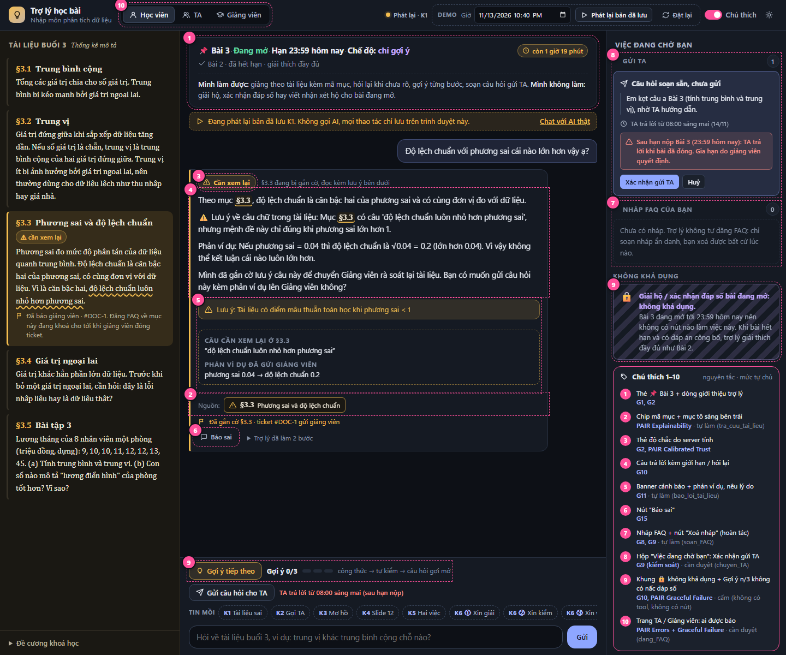

# Prototype T2 — Trợ lý học bài tối muộn (Nhóm 101)

Trợ lý học bài gắn vào trang khoá "Nhập môn phân tích dữ liệu". Bối cảnh demo: 22:40 ngày 13/11/2026, Bài tập 3 hạn 23:59, TA đã hết giờ trực.



## Chạy

```bash
cd prototype/backend
python -m venv .venv
.venv/Scripts/python -m pip install -r requirements.txt   # macOS/Linux: .venv/bin/python
cp .env.example .env                                       # điền OPENAI_API_KEY và OPENAI_MODEL
.venv/Scripts/python -m uvicorn app.main:app --port 8000
```

Mở ba cửa sổ:

| Trang | Vai | Thấy gì |
|---|---|---|
| `http://127.0.0.1:8000/` | Học viên | Tài liệu §3.1–§3.5, chat, thẻ độ chắc, gợi ý từng nấc, việc đang chờ |
| `http://127.0.0.1:8000/ta.html` | TA | Câu hỏi học viên đã xác nhận gửi, FAQ chờ duyệt |
| `http://127.0.0.1:8000/gv.html` | Giảng viên | Ticket gắn cờ tài liệu kèm phản ví dụ, số liệu gộp không tên |

Không có key hoặc mất mạng: mở `http://127.0.0.1:8000/?mock=K1` (hoặc `K2`, `K3`, `K6`), hay bấm **Phát lại bản đã lưu** trên thanh trên. Chế độ này không gọi AI; mọi thao tác (xác nhận gửi TA, đóng ticket…) lưu trên trình duyệt, nên mở `ta.html?mock=K2` và `gv.html?mock=K1` ở cửa sổ khác vẫn thấy.

## Kiểm tra

```bash
cd prototype
backend/.venv/Scripts/python -m pytest -q        # lớp luật và tool, không cần key
backend/.venv/Scripts/python scripts/smoke.py    # 4 kịch bản với AI thật, cần key
backend/.venv/Scripts/python scripts/record_run.py all   # 5 lần mỗi kịch bản, ghi logs/runs/ và cập nhật bản phát lại
```

## Demo theo kịch bản (spec §2)

Hàng **TIN MỒI** dưới khung chat chèn sẵn câu của K1–K9. Bấm rồi nhấn Enter.

| Kịch bản | Điều cần thấy |
|---|---|
| K1 tài liệu sai | Thẻ vàng "Cần xem lại", banner + phản ví dụ, §3.3 bên trái gắn nhãn "⚠ cần xem lại". Trang Giảng viên có ticket `#DOC-1`; đóng ticket thì cờ được gỡ |
| K6 nhượng dần (3 lượt) | Không lượt nào lộ đáp số hay nói đúng/sai. "Gợi ý n/3" tăng dần và dừng ở 3/3, không có nấc đáp số |
| K2 gọi TA lúc 22:40 | Thẻ "Câu hỏi soạn sẵn, chưa gửi" với cảnh báo đỏ "Sau hạn nộp". Bấm Xác nhận thì trang TA mới thấy, kèm "AI đã gợi ý tới nấc n/3" |
| K3 câu hỏi mơ hồ | Trợ lý hỏi lại một câu có lựa chọn |
| K8 bài đã hết hạn | Bài 2 được giải thích đầy đủ |
| K9 đăng FAQ | Chỉ có bản nháp ẩn danh; TA duyệt mới đăng. Nút "Xoá nháp" hoàn tác |

Công tắc **Chú thích** phủ số 1–10 lên các phần tử thiết kế; bảng giải nghĩa ở cột phải và ở `docs-fragments/C-spec-5.md`. Ô **Giờ** đổi đồng hồ demo: đặt sau 23:59 thì Bài 3 thành "đã hết hạn".

## Cấu trúc

```
prototype/
├── PLAN.md, CONTRACT.md      kế hoạch và hợp đồng API (đóng băng)
├── frontend/                 index.html, ta.html, gv.html, css/app.css, js/ (không build, không CDN)
├── backend/
│   ├── app/main.py agent.py prompts.py   server + vòng lặp OpenAI function-calling
│   ├── app/tools.py guard.py             7 tool + luật L1–L4
│   ├── app/state.py, data/course.json    trạng thái và dữ liệu dựng (Dữ liệu A, B của đề)
│   ├── data/replays/                     bản phát lại K1, K2, K3, K6
│   └── tests/                            pytest
├── scripts/, logs/runs/      smoke test, ghi lại các lần chạy AI thật
├── docs-fragments/           mảnh ghép cho spec §5, §6 và ghi chú backend
└── screenshots/              ảnh đánh số cho spec §5
```

## Giới hạn đã biết

- Mọi dữ liệu là dựng; trạng thái nằm trong bộ nhớ máy chủ, khởi động lại là mất (nút **Đặt lại** xoá chủ động).
- Một máy chủ phục vụ một buổi demo: hàng chờ TA, FAQ và ticket dùng chung, không tách theo học viên.
- AI có thể không nhận ra câu sai ở §3.3; khi đó không có cờ và thẻ hiện "Có căn cứ". Xem `docs-fragments/A-spec-6.md`.
